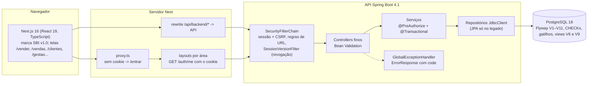
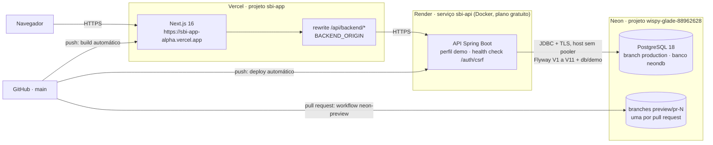

# Arquitetura do SBI

## Componentes



- O frontend segue o manual de marca SBI v1.0: tokens em `frontend/app/brand-tokens.css`, símbolo, logo e ícones em `frontend/components/brand/`, menu em seções GESTÃO, ATENDIMENTO e MEU ESPAÇO (D-EVO-32 a D-EVO-37).
- O frontend fala com a API sempre pela mesma origem (`/api/backend/*`, rewrite do Next). O cookie de sessão é HttpOnly e o token CSRF vai num cabeçalho em toda mutação (`frontend/lib/api/http.ts`).
- Os schemas Zod do frontend são gerados do contrato v5 (`config/openapi/target-loja-gestao-openapi-2026-10-14-v5.json`) pelo orval (`frontend/lib/api/generated/`). A CI falha se a geração produzir diff.
- A API valida a entrada com Bean Validation, responde todo erro como `ErrorResponse` com `code` e documenta as operações no Springdoc. O `scripts/live-contract.mjs` compara o OpenAPI ao vivo com o v5 (58 operações, relatório em `reports/contrato/live-v5/`).

## Camadas da API (módulos novos em `api/<módulo>/`)

| Camada | Papel | Exemplo |
| --- | --- | --- |
| Controller | Parâmetros (`@Valid`, `@Min`, `@Size`), usuário da sessão (`@AuthenticationPrincipal`), status HTTP | `SalesController` |
| Serviço | Regras, `@PreAuthorize` (segunda barreira), `@Transactional`, dono do dado (terceira barreira), `DbSessionContext` para os gatilhos, auditoria | `SalesService` |
| Repositório | SQL explícito com `JdbcClient` e `record`; nunca devolve custo ao vendedor | `SalesRepository` |
| DTOs | `record`s com Bean Validation; polimorfismo com `sealed interface` + `@JsonTypeInfo` | `SalesDtos` |

Módulos: `sales` (PDV), `customers` (cadastro, histórico e resumo do cliente), `backoffice` (produtos, categorias, estoque), `management` (faturamento, metas, estorno, análises), `promotions`, `discounts` (alçadas de desconto manual), `users` (cadastro de usuários e senha) e `common` (Money, paginação, endereço, usuário da sessão).

## Fluxo de venda

```mermaid
sequenceDiagram
  participant V as Vendedor (/vender)
  participant A as API
  participant B as PostgreSQL
  V->>A: POST /sales/quote (itens)
  A->>B: preços, promoções vigentes, disponível
  A-->>V: subtotal, desconto, total (calculados no servidor)
  V->>A: POST /sales/orders + Idempotency-Key
  A->>B: INSERT orders (UNIQUE seller_id + client_request_id)
  loop itens em ordem crescente de product_id
    A->>B: UPDATE stock_balance SET reserved = reserved + q WHERE on_hand - reserved >= q
  end
  A-->>V: 201 (ou 200 na repetição, 409 STOCK_INSUFFICIENT sem reserva parcial)
  V->>A: POST /sales/orders/{id}/payment
  A->>B: SELECT ... FOR UPDATE; baixa on_hand e reserved; grava custo do momento; SAIDA
  A-->>V: 200 PAID (repetir não tem efeito)
```

- O vendedor do pedido é sempre o usuário da sessão. Propriedade desconhecida no corpo responde 400, então ninguém envia preço, total ou vendedor.
- O cancelamento só vale para pedido pendente: libera a reserva com movimento `LIBERACAO`. Pedido pago responde 409.
- Os CHECKs do banco (`reserved <= on_hand`, `on_hand >= 0`) são a última barreira. A violação vira 409, nunca 500.
- Desconto manual (RF-26): a cotação e a venda aceitam percentual e motivo; o servidor confere a alçada do papel (VENDEDOR 5%, GERENTE 20%) e o custo médio, e rateia o valor nos itens (`order_item.manual_discount`), então faturamento e metas não mudam de sentido (D-EVO-20). Acima da alçada, o gerente aprova no pedido pendente (`/sales/orders/{id}/discount-approval`).

## Segurança em três barreiras

1. **URL**: `SecurityConfig` aplica a matriz `src/test/resources/security/access-matrix.csv`, com a hierarquia GERENTE > VENDEDOR. O `AccessMatrixTest` executa as 260 combinações (anônimo, vendedor, gerente) e falha se aparecer uma rota sem linha na matriz.
2. **Método**: `@PreAuthorize` em cada serviço, com a mesma hierarquia.
3. **Dono do dado**: o serviço confere o vendedor do pedido; objeto de outro dono responde 404, sem revelar que existe.

Complementos:
- sessão + CSRF;
- bloqueio após 5 falhas de login por 15 min, com resposta igual e BCrypt executado nos quatro casos;
- documento mascarado para o vendedor;
- custo e margem só para o gerente;
- cartão guarda só os 4 últimos dígitos;
- auditoria (`audit_event`) de login, cancelamento, ajuste de estoque, cliente, situação de produto, usuários e alçadas de desconto;
- contador de falhas de login por `UPDATE` atômico, sem corrida entre tentativas paralelas (D-EVO-01 a D-EVO-03);
- revogação de sessão: `app_users.session_version` muda quando o gerente altera papel, situação ou senha de alguém, e o `SessionVersionFilter` responde 401 `SESSION_REVOKED` na requisição seguinte (D-EVO-04);
- senha nova com 12 a 72 caracteres e 72 bytes, fora da lista comum e diferente do e-mail (D-EVO-05); senha provisória só libera `/conta/senha`;
- sempre um GERENTE ativo, garantido pelo gatilho `keep_one_active_manager` (D-EVO-08).

## Matriz de acesso resumida

| Área | Anônimo | Vendedor | Gerente |
| --- | --- | --- | --- |
| `/auth/login`, `/auth/csrf`, `/auth/logout` | sim | sim | sim |
| `/auth/me`, `/auth/password` (própria senha) | 401 | sim | sim |
| PDV (`/sales/*`, `/orders/{id}/cancel`) | 401 | sim (só os próprios pedidos; desconto até 5%) | sim (desconto até 20% e aprovação no pedido) |
| Clientes (`/customers`, histórico, resumo) | 401 | sim (documento mascarado; valores só das próprias vendas; não exclui) | sim |
| `/performance/me`, `/promotions/active` | 401 | sim | sim |
| Backoffice (`/products`, `/categories`, `/stock/*`) | 401 | 403 | sim |
| Gestão (`/management/*`, `/goals/*`, `/analytics/*`, `/promotions`, estorno) | 401 | 403 | sim |
| Usuários (`/users/*`) e alçadas (`/discount-policy`) | 401 | 403 | sim |
| Rotas legadas (`/orders`, `/payment`, `/address`) | 401 | 403 | sim |

A matriz completa, linha a linha, está em [decisoes/matriz-acesso.md](decisoes/matriz-acesso.md).

## Banco

O Flyway é a única fonte do esquema, e o Hibernate roda em `validate` em todos os perfis.

| Migração | Conteúdo |
| --- | --- |
| V1–V4 | Legado e dinheiro em NUMERIC(12,2) |
| V5 | Catálogo, estoque com custo médio por gatilho, promoções, metas com soma checada no commit, idempotência e auditoria |
| V6 | Views dos painéis |
| V7 | Mascara cartões legados |
| V8 | Cadastro de usuários: `session_version`, senha provisória, auditoria e o gatilho de um GERENTE ativo |
| V9 | `v_cliente_resumo` (grão cliente × vendedor, mesma regra do faturamento) |
| V10 | CNPJ alfanumérico |
| V11 | Desconto manual: alçadas em `discount_policy`, parte manual no item e aprovação no pedido |

O seed demo fica em `db/demo`. Detalhes em [bd/modelo-erp-pdv.md](bd/modelo-erp-pdv.md).

## Ambientes e testes

| Ambiente | Banco | Uso |
| --- | --- | --- |
| Desenvolvimento | `postgres-order` (README) | Uso diário; nunca recebe testes. |
| Testes de integração e contrato | PostgreSQL 18 descartável via Docker Compose (`docker-compose.test.yml`, porta 15432) | Perfil `integration`; as tabelas de negócio são esvaziadas por `TRUNCATE` entre os testes. A CI usa o mesmo PostgreSQL 18 como serviço. Testcontainers não é usado (D-EVO-38). |
| Demonstração | PostgreSQL 18 em `tmpfs`, publicado só em `127.0.0.1:5433` (`docker-compose.demo.yml`) | Seed demo mais a massa Olist carregada por SQL puro (`docs/bd/pacote-sql/07_carga_olist.sql`), acessível ao IntelliJ, DBeaver ou `psql` ([bd/massa-demonstracao.md](bd/massa-demonstracao.md)). |
| Publicado | Neon (PostgreSQL 18), projeto `wispy-glade-88962628`, branch `production` | Perfil `demo` aplicado pelo Flyway a cada deploy do Render; contas renomeadas para a equipe; massa Olist pelo mesmo `07_carga_olist.sql`. Cada PR ganha uma branch Neon própria ([deploy.md](deploy.md)). |

## Ambiente publicado

O navegador só conversa com a Vercel; a API e o banco ficam atrás do rewrite, então o cookie de sessão (`HttpOnly`, `Secure`, `SameSite=Lax`) é da mesma origem do site e não há CORS. Endereços, regiões e variáveis em [deploy.md](deploy.md).


