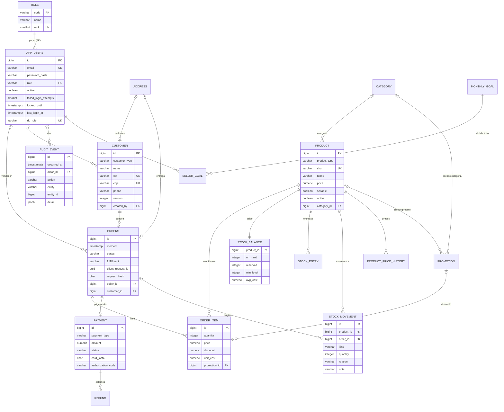

# Modelo ERP/PDV — estado-alvo após V5 e V6

Data: 14/10/2026. Etapa: ETAPA 1 (modelagem). **Proposta**: nada deste documento está em `src/main/resources/db/migration/`. As migrações são escritas na ETAPA 2A, depois que a `V4__money_numeric` (PR #9/#10) estiver na `main`.

Base: `V1`–`V3` da `main` (`57c3c70`), `V4__money_numeric` da branch `fix/FIX-03-pagamento-dinheiro`, pacote SQL da disciplina de 12/10 (`01`–`06`) e os ajustes D1–D10 abaixo. Decisões em uma frase: [erp-pdv.md](../decisoes/erp-pdv.md). Modelo implementado hoje: [dicionario-dados.md](dicionario-dados.md).

## 1. Composição das migrações

| Migração | Conteúdo |
| --- | --- |
| `V5__catalogo_estoque_metas_promocoes` | Pré-checagem dos dados legados (seção 4.1); seções V5–V9 do `01_evolucao_schema.sql` adaptadas (seção 1.1); D1–D8 e D10; funções `fn_*` para a demonstração via `psql` e para o job `bd` (a API não as chama, decisão A4). |
| `V6__views_dashboards` | As 15 views do `02_views_dashboards.sql`, com `v_catalogo_vendedor` filtrando `sellable`, mais `v_faturamento_diario` (D9). |
| `db/demo` (perfil `demo`) | Contas de demonstração com BCrypt de `SBI_DEMO_PASSWORD` e massa do `04_seed_demo.sql` com CPFs válidos (seção 8). |

Se a V5 já estiver publicada quando a ETAPA 2A começar, as mudanças entram em `V7__erp_pdv`. Migração publicada nunca é editada.

### 1.1 Adaptações obrigatórias do pacote

| # | Adaptação | Motivo |
| --- | --- | --- |
| P1 | Toda função e gatilho troca `SET search_path = public, pg_temp` por `SET search_path = ${flyway:defaultSchema}, pg_temp`. | Migrar nos esquemas `flyway_test_*` e `ci_flyway`. Com o placeholder, V5/V6 só rodam pelo Flyway, nunca por `psql` direto. |
| P2 | A seção V4 do pacote não entra (já é a `V4__money_numeric`). | Evita conversão duplicada. |
| P3 | O `CHECK ck_app_users_role` não é criado; a FK de D1 o substitui. | D1. |
| P4 | `ck_payment_status` nasce com `EXPIRED`. | D10: o enum Java já tem `EXPIRED` e o boleto vencido usa esse estado. |
| P5 | `stock_movement.kind` nasce `varchar(16)` com `AJUSTE_ENTRADA`/`AJUSTE_SAIDA` no lugar de `AJUSTE`. | D6: `AJUSTE_ENTRADA` tem 14 caracteres. |
| P6 | `ix_orders_customer_id` não é criado; `ix_orders_customer_moment` o substitui. | D5: o índice composto atende o mesmo prefixo. |
| P7 | `fn_criar_pedido` percorre os itens em ordem crescente de `product_id`, exige `active AND sellable` e grava `fulfillment = 'PICKUP'`; `fn_confirmar_pagamento` e `fn_cancelar_pedido` usam `ORDER BY product_id`. | Regra 3 da seção 7 (ordem de bloqueio contra deadlock), D4 e D5. |
| P8 | `app_users.db_role` é mantido. | `app_current_user_id()` e a RLS do `03_rbac.sql` dependem dele para a demonstração por login de banco. |
| P9 | Blocos `BEGIN; ... COMMIT;` saem do seed. | O Flyway já envolve cada migração numa transação. |

## 2. Diagrama entidade-relacionamento (após V5/V6)



Tabelas sem atributos no diagrama seguem o pacote sem mudança: `address`, `category`, `product_price_history`, `promotion`, `stock_entry`, `refund`, `monthly_goal`, `seller_goal`. As 16 views do V6 (15 do pacote + `v_faturamento_diario`) leem essas tabelas e não aparecem no diagrama.

## 3. Mapeamento das entidades pedidas

| Entidade pedida | Tabela(s) | JPA na ETAPA 2A/2C | Observação |
| --- | --- | --- | --- |
| Users | `app_users` | `AppUser` (+ `active`, `failedLoginAttempts`, `lockedUntil`, `lastLoginAt`, `createdAt`) | Contas só pelo seed demo (DEC-ERP-07). |
| Roles | `role` | `Role` somente leitura; `AppUser.role` continua `UserRole` (`@Enumerated`), coluna com FK | A hierarquia efetiva vive no `RoleHierarchy`; `rank` documenta a ordem. |
| Customers | `customer` + `address` | `Customer` (`SINGLE_TABLE`, `@Version`) | `@CPF`/`@CNPJ` só nos DTOs. |
| Products | `product` + `category` + `product_price_history` | `Product` (+ `sku`, `sellable`, `active`, `category`), `Category`, `ProductPriceHistory` somente leitura | Histórico de preço gravado pelo gatilho. |
| Inventory | `stock_balance` + `stock_entry` + `stock_movement` | `StockBalance`, `StockEntry`, `StockMovement` | Saldo e custo médio atualizados pelo gatilho da entrada; reserva por `UPDATE` condicional. |
| Orders | `orders` | `Order` (+ `fulfillment`, `clientRequestId`, `requestHash`) | Vendedor sempre da sessão. |
| OrderItems | `order_item` | `OrderItem` (+ `discount`, `unitCost`, `promotion`) | Preço histórico; `unit_cost` gravado na confirmação. |
| (apoio) | `payment`, `refund`, `promotion`, `monthly_goal`, `seller_goal`, `audit_event` | entidades homônimas | `audit_event` só recebe inserção. |
| (painéis) | views `v_*` | consultas por `JdbcClient` com `record` | Decisão B-09: views não viram entidade. |

## 4. DDL proposto (D1–D10)

O bloco abaixo foi ensaiado em PostgreSQL 18 (seção 7). Linhas marcadas `-- ensaio` só existem porque o ensaio aplica o pacote inalterado antes do bloco; na V5 o objeto do pacote nasce já na forma final (adaptações P3–P6).

### 4.1 Pré-checagem (primeira instrução da V5)

```sql
DO $$
DECLARE v text;
BEGIN
    SELECT string_agg(d, ', ') INTO v FROM (
        SELECT regexp_replace(cpf, '[^0-9]', '', 'g') AS d FROM customer WHERE cpf IS NOT NULL
        GROUP BY 1 HAVING count(*) > 1
        UNION ALL
        SELECT regexp_replace(cnpj, '[^0-9]', '', 'g') FROM customer WHERE cnpj IS NOT NULL
        GROUP BY 1 HAVING count(*) > 1) x;
    IF v IS NOT NULL THEN
        RAISE EXCEPTION 'V5: documentos colidem apos normalizacao para digitos: %', v;
    END IF;
    SELECT string_agg(id::text, ', ') INTO v FROM customer
     WHERE NOT ((customer_type = 'INDIVIDUAL' AND cpf IS NOT NULL AND cnpj IS NULL)
             OR (customer_type = 'CORPORATE' AND cnpj IS NOT NULL AND cpf IS NULL))
        OR (cpf IS NOT NULL AND regexp_replace(cpf, '[^0-9]', '', 'g') !~ '^[0-9]{11}$')
        OR (cnpj IS NOT NULL AND regexp_replace(cnpj, '[^0-9]', '', 'g') !~ '^[0-9]{14}$');
    IF v IS NOT NULL THEN
        RAISE EXCEPTION 'V5: clientes com documento incoerente com o tipo ou fora do formato (ids: %)', v;
    END IF;
    SELECT string_agg(id::text, ', ') INTO v FROM product WHERE price <= 0;
    IF v IS NOT NULL THEN RAISE EXCEPTION 'V5: produtos com preco <= 0 (ids: %)', v; END IF;
    SELECT string_agg(id::text, ', ') INTO v FROM order_item WHERE quantity <= 0 OR price < 0;
    IF v IS NOT NULL THEN RAISE EXCEPTION 'V5: itens com quantidade ou preco invalidos (ids: %)', v; END IF;
    SELECT string_agg(DISTINCT status, ', ') INTO v FROM orders
     WHERE status NOT IN ('PENDING_PAYMENT','PROCESSING','PAID','SHIPPED','DELIVERED','CANCELED');
    IF v IS NOT NULL THEN RAISE EXCEPTION 'V5: status de pedido fora do dominio: %', v; END IF;
    SELECT string_agg(DISTINCT status, ', ') INTO v FROM payment
     WHERE status NOT IN ('PENDING','APPROVED','DECLINED','EXPIRED');
    IF v IS NOT NULL THEN RAISE EXCEPTION 'V5: status de pagamento fora do dominio: %', v; END IF;
    SELECT string_agg(DISTINCT role, ', ') INTO v FROM app_users WHERE role NOT IN ('GERENTE','VENDEDOR');
    IF v IS NOT NULL THEN RAISE EXCEPTION 'V5: papel de usuario desconhecido: %', v; END IF;
END $$;
```

A pré-checagem cobre a D3 (documentos) e os CHECKs que o pacote acrescenta sobre dados legados (preço, quantidade, estados, papel). Não existe banco não descartável (A2A-2): se ela encontrar dado inválido, a migração falha com mensagem clara, e nenhum dado é corrigido pela migração.

### 4.2 D1 — papéis

```sql
CREATE TABLE role (
    code varchar(20) PRIMARY KEY,
    name varchar(60) NOT NULL,
    rank smallint    NOT NULL UNIQUE
);
INSERT INTO role(code, name, rank) VALUES ('GERENTE', 'Gerente', 20), ('VENDEDOR', 'Vendedor', 10);
ALTER TABLE app_users DROP CONSTRAINT ck_app_users_role;  -- ensaio
ALTER TABLE app_users ADD CONSTRAINT fk_app_users_role FOREIGN KEY (role) REFERENCES role(code);
```

### 4.3 D2 — situação da conta e bloqueio

```sql
ALTER TABLE app_users
    ADD COLUMN active                boolean     NOT NULL DEFAULT true,
    ADD COLUMN failed_login_attempts smallint    NOT NULL DEFAULT 0,
    ADD COLUMN locked_until          timestamptz,
    ADD COLUMN last_login_at         timestamptz,
    ADD COLUMN created_at            timestamptz NOT NULL DEFAULT now(),
    ADD CONSTRAINT ck_app_users_failed_attempts CHECK (failed_login_attempts >= 0);
```

### 4.4 D3 — cliente

```sql
UPDATE customer SET cpf  = regexp_replace(cpf,  '[^0-9]', '', 'g') WHERE cpf  IS NOT NULL;
UPDATE customer SET cnpj = regexp_replace(cnpj, '[^0-9]', '', 'g') WHERE cnpj IS NOT NULL;
ALTER TABLE customer
    ADD COLUMN phone      varchar(20),
    ADD COLUMN version    integer     NOT NULL DEFAULT 0,
    ADD COLUMN created_by bigint      DEFAULT app_current_user_id() REFERENCES app_users(id),
    ADD COLUMN created_at timestamptz NOT NULL DEFAULT now(),
    ADD COLUMN updated_at timestamptz NOT NULL DEFAULT now(),
    ADD CONSTRAINT ck_customer_cpf  CHECK (cpf  ~ '^[0-9]{11}$'),
    ADD CONSTRAINT ck_customer_cnpj CHECK (cnpj ~ '^[0-9]{14}$'),
    ADD CONSTRAINT ck_customer_document_type CHECK (
        (customer_type = 'INDIVIDUAL' AND cpf IS NOT NULL AND cnpj IS NULL)
     OR (customer_type = 'CORPORATE'  AND cnpj IS NOT NULL AND cpf IS NULL));
CREATE INDEX ix_customer_name_prefix ON customer (lower(name) text_pattern_ops);
```

O banco confere formato e coerência; o dígito verificador é conferido só pelo `@CPF`/`@CNPJ` do DTO de requisição, porque os clientes legados não foram validados. A unicidade continua nos `UNIQUE` da V1. Clientes legados ficam com `created_by = NULL` e `created_at` igual ao instante da migração.

### 4.5 D4 — produto

```sql
ALTER TABLE product
    ADD COLUMN sellable boolean NOT NULL DEFAULT true,
    ADD CONSTRAINT ck_product_sku_upper CHECK (sku = upper(sku));
CREATE INDEX ix_product_name_prefix ON product (lower(name) text_pattern_ops);
```

`sku` continua anulável (produtos legados não têm SKU); a API exige SKU em todo cadastro novo.

### 4.6 D5 — pedido: idempotência e retirada/entrega

```sql
ALTER TABLE orders
    ADD COLUMN client_request_id uuid,
    ADD COLUMN request_hash      char(64);
ALTER TABLE orders ADD COLUMN fulfillment varchar(10);
UPDATE orders SET fulfillment = CASE WHEN address_id IS NOT NULL THEN 'DELIVERY' ELSE 'PICKUP' END;
ALTER TABLE orders ALTER COLUMN fulfillment SET DEFAULT 'PICKUP';
ALTER TABLE orders ALTER COLUMN fulfillment SET NOT NULL;
ALTER TABLE orders
    ADD CONSTRAINT ck_orders_fulfillment CHECK (fulfillment IN ('PICKUP', 'DELIVERY')),
    ADD CONSTRAINT ck_orders_delivery_address CHECK (fulfillment <> 'DELIVERY' OR address_id IS NOT NULL),
    ADD CONSTRAINT ck_orders_request_pair CHECK ((client_request_id IS NULL) = (request_hash IS NULL)),
    ADD CONSTRAINT ck_orders_request_hash CHECK (request_hash ~ '^[0-9a-f]{64}$'),
    ADD CONSTRAINT uq_orders_seller_request UNIQUE (seller_id, client_request_id);
DROP INDEX ix_orders_customer_id;  -- ensaio
CREATE INDEX ix_orders_customer_moment ON orders (customer_id, moment DESC);
```

`ck_orders_request_pair` e `ck_orders_request_hash` vão além do pedido original: chave sem hash (ou hash fora do formato hexadecimal minúsculo do SHA-256) tornaria a comparação de repetição impossível. Pedidos legados ficam com os dois campos nulos.

### 4.7 D6 — movimentos de estoque

```sql
ALTER TABLE stock_movement DROP CONSTRAINT stock_movement_kind_check;  -- ensaio
ALTER TABLE stock_movement ALTER COLUMN kind TYPE varchar(16);
ALTER TABLE stock_movement
    ADD COLUMN reason varchar(20),
    ADD COLUMN note   varchar(200),
    ADD CONSTRAINT ck_stock_movement_kind CHECK (kind IN ('ENTRADA','RESERVA','LIBERACAO','SAIDA','DEVOLUCAO',
                                                          'AJUSTE_ENTRADA','AJUSTE_SAIDA')),
    ADD CONSTRAINT ck_stock_movement_reason CHECK (reason IN ('PERDA','AVARIA','USO_INTERNO','INVENTARIO',
                                                              'DEVOLUCAO_FORNECEDOR')),
    ADD CONSTRAINT ck_stock_movement_reason_required CHECK ((kind IN ('AJUSTE_ENTRADA','AJUSTE_SAIDA')) = (reason IS NOT NULL)),
    ADD CONSTRAINT ck_stock_movement_in_reason CHECK (kind <> 'AJUSTE_ENTRADA' OR reason = 'INVENTARIO');
CREATE INDEX ix_stock_movement_created_at ON stock_movement (created_at DESC);
```

`ck_stock_movement_in_reason` vai além do pedido original: ajuste de entrada só faz sentido por inventário; perda, avaria, uso interno e devolução ao fornecedor são saídas.

### 4.8 D7 — auditoria

```sql
CREATE TABLE audit_event (
    id          bigint GENERATED BY DEFAULT AS IDENTITY PRIMARY KEY,
    occurred_at timestamptz NOT NULL DEFAULT now(),
    actor_id    bigint REFERENCES app_users(id),
    action      varchar(40) NOT NULL,
    entity      varchar(40),
    entity_id   bigint,
    detail      jsonb,
    CONSTRAINT ck_audit_event_action CHECK (action IN (
        'LOGIN_SUCCEEDED','LOGIN_FAILED','ACCOUNT_LOCKED','LOGOUT','CUSTOMER_CREATED','CUSTOMER_UPDATED',
        'CUSTOMER_DELETED','STOCK_ADJUSTED','PRODUCT_STATUS_CHANGED','ORDER_CANCELED'))
);
CREATE INDEX ix_audit_event_entity   ON audit_event (entity, entity_id);
CREATE INDEX ix_audit_event_occurred ON audit_event (occurred_at);
```

`detail` nunca recebe senha nem documento completo; em `LOGIN_FAILED` de e-mail inexistente, `actor_id` é nulo e o e-mail tentado vai como `{"emailSha256": "<hex>"}`.

### 4.9 D8 — pagamento no balcão

```sql
ALTER TABLE payment
    ADD COLUMN card_last4         char(4),
    ADD COLUMN authorization_code varchar(20),
    ADD CONSTRAINT ck_payment_card_last4 CHECK (card_last4 ~ '^[0-9]{4}$'),
    ADD CONSTRAINT ck_payment_card_last4_type CHECK (card_last4 IS NULL OR payment_type = 'CARD');
```

A coluna `card_number` não serve: o `/payment` legado grava nela o número informado, sem limite de dígitos. Reaproveitá-la misturaria número completo e final do cartão na mesma coluna. O PDV nunca escreve `card_number` (DEC-ERP-04). `installments` e `due_date` são reaproveitadas.

### 4.10 D9 — `v_faturamento_diario` (V6)

```sql
CREATE OR REPLACE VIEW v_faturamento_diario AS
WITH venda AS (
    SELECT l.data                                                      AS dia,
           l.order_id,
           l.valor                                                     AS bruto,
           sum(oi.quantity)                                            AS unidades,
           sum(oi.unit_cost * oi.quantity)                             AS custo_conhecido,
           sum(oi.price * oi.quantity - oi.discount) FILTER (WHERE oi.unit_cost IS NOT NULL) AS receita_com_custo,
           count(*) FILTER (WHERE oi.unit_cost IS NULL)                AS itens_sem_custo
      FROM v_lancamento_realizado l
      JOIN order_item oi ON oi.order_id = l.order_id
     WHERE l.tipo = 'VENDA'
     GROUP BY l.data, l.order_id, l.valor
), venda_dia AS (
    SELECT dia, sum(bruto) AS bruto, count(*) AS pedidos_pagos, sum(unidades) AS unidades,
           coalesce(sum(custo_conhecido), 0) AS custo_conhecido,
           coalesce(sum(receita_com_custo), 0) AS receita_com_custo, sum(itens_sem_custo) AS itens_sem_custo
      FROM venda GROUP BY dia
), estorno_dia AS (
    SELECT data AS dia, -sum(valor) AS estornos
      FROM v_lancamento_realizado WHERE tipo = 'ESTORNO' GROUP BY data
)
SELECT coalesce(v.dia, e.dia)                                  AS dia,
       coalesce(v.bruto, 0)                                    AS faturamento_bruto,
       coalesce(e.estornos, 0)                                 AS estornos,
       coalesce(v.bruto, 0) - coalesce(e.estornos, 0)          AS faturamento_liquido,
       coalesce(v.pedidos_pagos, 0)                            AS pedidos_pagos,
       coalesce(v.unidades, 0)                                 AS unidades,
       coalesce(v.custo_conhecido, 0)                          AS custo_conhecido,
       coalesce(v.receita_com_custo, 0)                        AS receita_com_custo,
       coalesce(v.itens_sem_custo, 0)                          AS itens_sem_custo,
       CASE WHEN coalesce(v.itens_sem_custo, 0) = 0
            THEN coalesce(v.bruto, 0) - coalesce(e.estornos, 0) - coalesce(v.custo_conhecido, 0) END AS lucro_bruto
  FROM venda_dia v
  FULL JOIN estorno_dia e ON e.dia = v.dia;
```

Regras: o dia é a data do pagamento confirmado (vendas) ou do estorno, em America/Fortaleza; lucro bruto = faturamento líquido − custo conhecido; `lucro_bruto` é nulo no dia em que algum item vendido não tem custo. `/management/revenue` soma os dias do período: `grossProfit` é nulo se algum dia for nulo, `costCoveragePercent = receita_com_custo / faturamento_bruto × 100` e `grossMarginPercent = grossProfit / netRevenue × 100` (1 casa, HALF_UP).

### 4.11 D10 — domínios coerentes com o Java

```sql
ALTER TABLE payment DROP CONSTRAINT ck_payment_status;  -- ensaio
ALTER TABLE payment ADD CONSTRAINT ck_payment_status CHECK (status IN ('PENDING','APPROVED','DECLINED','EXPIRED'));
```

`OrderStatus` ganha `CANCELED` no Java (o `ck_orders_status` do pacote já o prevê). A tabela de transições da FIX-02 (`OrderStatus.allowedNext`) precisa aceitar `PENDING_PAYMENT -> CANCELED` e nenhuma transição a partir de `CANCELED`.

## 5. Índices e as consultas que atendem

| Índice | Origem | Consulta |
| --- | --- | --- |
| `ix_customer_name_prefix` `(lower(name) text_pattern_ops)` | D3 | `GET /customers?q=mar`: `WHERE lower(name) LIKE lower(:q) \|\| '%' ORDER BY name` (com `%` e `_` escapados em `:q`). |
| `UNIQUE (cpf)`, `UNIQUE (cnpj)` | V1 | `GET /customers?q=<dígitos>`: `WHERE cpf = :d OR cnpj = :d`; também a unicidade de RF-20. |
| `ix_orders_customer_moment` `(customer_id, moment DESC)` | D5 | `GET /customers/{id}/orders` ordenado do mais recente; `ordersCount`/`lastOrderAt`; checagem de pedido antes do `DELETE /customers/{id}`. |
| `idx_orders_seller_id` | V2 | `GET /sales/orders` do VENDEDOR (`WHERE seller_id = :me`); `v_desempenho_vendedor`. |
| `uq_orders_seller_request` `(seller_id, client_request_id)` | D5 | Busca de repetição da `Idempotency-Key` e barreira contra corrida. |
| `UNIQUE (sku)` | pacote V6 | `GET /sales/catalog?q=IP-128-PT`: SKU exato primeiro. |
| `ix_product_name_prefix` | D4 | `GET /sales/catalog`, `GET /products`, `GET /stock/products` com `q` por prefixo do nome. |
| `ix_product_category_id` | pacote V6 | Promoção por categoria; filtro de catálogo por categoria. |
| `ix_order_item_order_id` | pacote V5 | Itens do pedido (resposta da venda, confirmação, cancelamento) e views. |
| `ix_order_item_product_id` | pacote V5 | `DELETE /products/{id}` ("já vendido?") e `v_margem_produto`. |
| `ix_price_history_product` `(product_id, changed_at DESC)` | pacote V6 | `GET /products/{id}/price-history`. |
| `ix_stock_entry_product` | pacote V8 | Entradas de um produto. |
| `ix_stock_movement_product` `(product_id, created_at)` | pacote V8 | `GET /stock/movements?productId=&from=&to=`. |
| `ix_stock_movement_order` | pacote V8 | Movimentos de um pedido (prova de SAIDA única, BD-19/CT-STOCK-106). |
| `ix_stock_movement_created_at` `(created_at DESC)` | D6 | `GET /stock/movements` sem produto, ordenado por data. |
| `stock_balance` PK `(product_id)` | pacote V8 | Reserva atômica `UPDATE ... WHERE product_id = :id AND on_hand - reserved >= :q`. |
| `ix_refund_payment` | pacote V8 | Total já estornado de um pagamento (`remaining`). |
| `UNIQUE (period)` em `monthly_goal`; `uq_seller_goal` | pacote V9 | `GET/PUT /goals/monthly?period=`. |
| `ix_audit_event_entity` `(entity, entity_id)` | D7 | Trilha de um cliente, produto ou pedido. |
| `ix_audit_event_occurred` `(occurred_at)` | D7 | Consulta de auditoria por período. |
| `UNIQUE (email)` em `app_users` | V2 | Login. |
| `UNIQUE (order_id)` em `payment` | V1 | Pagamento do pedido na confirmação e no cancelamento. |

Não foram propostos índices para `promotion(product_id)`/`promotion(category_id)` e `customer(created_by)`: as tabelas são pequenas e nenhuma consulta da seção 6 do contrato filtra por essas colunas sem outro critério. Reavaliar com `EXPLAIN` sobre o seed demo na ETAPA 2C.

## 6. Invariantes e quem as garante

| Invariante | CHECK / FK / UNIQUE | Gatilho | Serviço |
| --- | --- | --- | --- |
| `0 <= reserved <= on_hand` (disponível nunca negativo) | `ck_stock_reserved_le_on_hand`, `on_hand >= 0`, `reserved >= 0` | — | `UPDATE` condicional; violação vira 409, nunca 500 |
| Todo produto tem linha de saldo | PK `stock_balance` | `product_stock_row` | — |
| Custo médio ponderado; custo desconhecido nunca vira zero | `unit_cost >= 0` | `stock_entry_apply` | API não recalcula |
| Histórico de preço com autor e motivo | — | `product_price_history` (lê `app.user_id`/`app.reason`) | `DbSessionContext` define `app.reason` |
| Promoção só por gerente | `ck_promotion_*` (janela, percentual, escopo) | `promotion_only_manager` | `@PreAuthorize` GERENTE |
| Meta individual só de VENDEDOR; soma = meta da loja | `uq_seller_goal`, `amount >= 0` | `seller_goal_is_seller`; `seller_goal_sum`/`monthly_goal_sum` (adiados ao COMMIT) | 409 na violação |
| Desconto ≤ valor do item | `ck_order_item_discount`, `discount >= 0` | — | Cálculo HALF_UP no servidor |
| Quantidade e preço válidos | `ck_order_item_qty`, `ck_order_item_price`, `ck_product_price` | — | Bean Validation 1..999 |
| Estados de pedido e pagamento no domínio | `ck_orders_status`, `ck_payment_status`, `ck_payment_type` | — | Enums Java |
| Entrega exige endereço | `ck_orders_delivery_address` | — | Restrição de classe no DTO |
| Uma venda por `Idempotency-Key` e vendedor | `uq_orders_seller_request`, `ck_orders_request_pair` | — | Hash canônico; releitura em nova transação |
| Documento só com dígitos, coerente com o tipo e único | `ck_customer_cpf`, `ck_customer_cnpj`, `ck_customer_document_type`, `UNIQUE` | — | `@CPF`/`@CNPJ` (dígito verificador); 409 `DUPLICATE_DOCUMENT` |
| Cliente com pedido não é excluído | FK `orders.customer_id` | — | 409 `RESOURCE_IN_USE` antes do DELETE |
| Produto vendido não é excluído | FK `order_item.product_id` | — | 409; usar inativação |
| Ajuste exige motivo; entrada por ajuste só por inventário | `ck_stock_movement_reason_required`, `ck_stock_movement_in_reason` | — | Bean Validation |
| Vendedor do pedido = sessão | FK `seller_id` | — | DTO sem campo; propriedade extra → 400 |
| Objeto de outro vendedor invisível | — | — | Filtro por dono; 404 |
| Confirmação de pagamento com uma única SAIDA | — | — | `SELECT ... FOR UPDATE`; PAID → retorno sem efeito |
| Ordem de bloqueio por `product_id` | — | — | Itens ordenados antes dos `UPDATE`; `fn_*` idem (P7) |
| Papel existente | `fk_app_users_role` | — | — |
| Cartão só com final de 4 dígitos | `ck_payment_card_last4`, `ck_payment_card_last4_type` | — | DTO sem número completo |
| Edição concorrente de cliente | `version` | — | `@Version` → 409 `CONCURRENT_UPDATE` |
| Bloqueio após 5 falhas | `ck_app_users_failed_attempts` | — | `LoginAttemptService` com `Clock` |

## 7. Ensaio executado em 14/10/2026

Ambiente: contêiner `postgres:18` descartável, removido ao final. Sequência: `V1`–`V3` da `main`, `V4__money_numeric` da `fix/FIX-03-pagamento-dinheiro`, `01_evolucao_schema.sql`, `02_views_dashboards.sql`, o DDL das seções 4.1–4.9 e 4.11, a view da 4.10, `03_rbac.sql`, `04_seed_demo.sql`, `05_crud_exemplos.sql` (login `gerente_rafael`), `06a`/`06b`/`06c` e a corrida CC-01 do `run_all.sh`.

| Verificação | Resultado |
| --- | --- |
| Aplicação sobre base com legado (CPF `529.982.247-25`, CNPJ `12.345.678/0001-95`, pedido com e sem endereço) | Aplicou sem erro; documentos gravados como `52998224725` e `12345678000195`; pedidos legados classificados como `DELIVERY` e `PICKUP`. |
| Base com dois CPFs que colidem após normalização | A pré-checagem abortou: `V5: documentos colidem apos normalizacao para digitos: 52998224725`. |
| Testes 06a/06b/06c do pacote com o bloco D aplicado | 50 PASS, 0 FAIL, 0 ERROR. |
| CC-01 (duas vendas simultâneas da última unidade) | Reservado/saldo = 1/1; a segunda venda recebeu `estoque insuficiente`. Com os 50, fecha os 51 PASS de 12/10. |
| `v_faturamento_diario` sobre o seed de setembro | Faturamento bruto 186.400,00, 65 pedidos pagos, 92 unidades; 16 dos 27 dias com `lucro_bruto` nulo só com a V6_2 (iPhone e AirPods sem custo, como no Guia Visual); com a V11_2 do perfil `demo`, que informa o custo da carga inicial desses dois produtos, nenhum dia fica nulo e o BD-07 usa um produto próprio sem custo. |

O ensaio não exercitou as adaptações P1, P7 e P9 nem o seed com CPFs válidos; elas são entregues e testadas na ETAPA 2A.

## 8. Seed de demonstração

- CPFs válidos e fictícios que substituem `00000000101`–`00000000106`: `10000000108`, `10000000280`, `10000000361`, `10000000442`, `10000000523`, `10000000604`. CNPJ fictício para um cliente PJ de demonstração: `12345678000195`.
- Contas (gerente Rafael; vendedores Ana, Bruno, Carla) criadas por migração Java no perfil `demo`, com BCrypt(12) de `SBI_DEMO_PASSWORD`; sem a variável, a aplicação não sobe nesse perfil (A8).
- Versões `V6_1` (contas, Java) e `V6_2` (massa SQL) em `classpath:db/demo`: ficam depois da V6 e antes de qualquer V7, com `outOfOrder` desligado. Por isso o perfil `demo` precisa estar ativo desde a primeira migração do banco (A2A-4); um banco migrado sem ele além da V6 é recriado, não completado.
- Os testes 06 que citam os CPFs antigos são ajustados junto com o seed.

## 9. Pendências para a ETAPA 2A

- `card_number` do legado fica sem CHECK na ETAPA 2A; a correção do defeito D022 (N-05) é da ETAPA 2C.

- Pré-condição: `V4__money_numeric.sql` listado em `git ls-tree -r --name-only origin/main src/main/resources/db/migration`. Atendida em 14/10 pelo squash do PR #10 (`ac064e4`); o #9 foi fechado ([integracao-fase0.md](../decisoes/integracao-fase0.md)).
- `application.properties` da `main` ainda usa `ddl-auto=update` com Flyway desligado; a decisão A2 (Flyway + `validate` em todos os perfis) é aplicada na 2A.
- `POST /orders` legado: a entidade `Order` precisa gravar `fulfillment = DELIVERY` quando houver endereço; sem isso, o default `PICKUP` vale também para pedidos com entrega.
- `POST /customers` legado: normalizar o documento para dígitos antes de salvar; sem isso, CPF com máscara viola `ck_customer_cpf` e cai no handler genérico de `DataIntegrityViolationException`, que hoje responde "This order already has a payment.".
- `Order.moment` é `timestamp` sem fuso e as views assumem America/Fortaleza; a hora deve vir de um `Clock` com essa zona (decisão B-10), porque a CI roda em UTC.
